# SOC Home Lab

A small security monitoring lab I built on my laptop to practise the work a SOC analyst does every day. A Windows 11 machine sends its logs into Splunk, I do things on that machine that attackers often do, and then I write Splunk searches that catch each one.

Everything here was done by hand: setting up the machine, getting the logs into Splunk, generating the activity and writing the searches.

## What I used

| Tool | What it does in the lab |
|---|---|
| VirtualBox | Runs the Windows 11 virtual machine |
| Windows 11 Enterprise (evaluation) | The machine being monitored |
| Sysmon with the SwiftOnSecurity config | Logs detailed process and network activity |
| Windows Security and System logs | Logins, account changes, scheduled tasks |
| Splunk Enterprise 10.6 | Collects the logs so I can search them |

## How it fits together

```
Windows 11 VM
   |
   |  Sysmon log + Security log + System log
   v
Splunk (same VM)  ->  index "lab"  ->  my searches
```

## Setup

### 1. Windows VM

I made a Windows 11 VM in VirtualBox with 8 GB RAM and 4 CPUs, and used a local account instead of a Microsoft account.

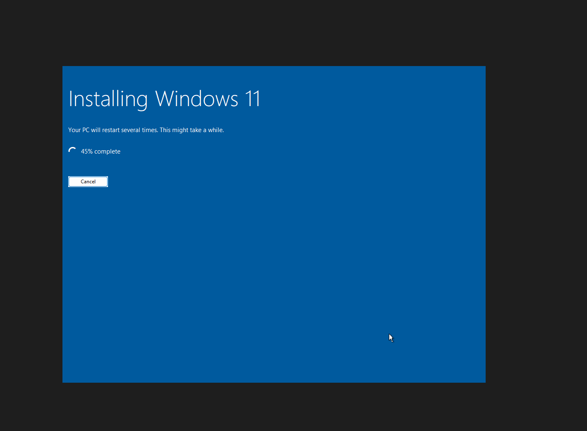

### 2. Sysmon

I installed Sysmon with the SwiftOnSecurity config, which is a common starting point for analysts. Sysmon writes to its own log in Event Viewer.

```
Sysmon64.exe -accepteula -i sysmonconfig-export.xml
```

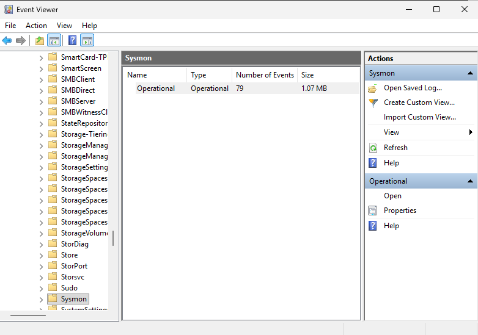

### 3. Extra Windows auditing

Windows does not log new scheduled tasks by default, so I turned it on:

```
auditpol /set /subcategory:"Other Object Access Events" /success:enable /failure:enable
```

### 4. Splunk

I installed Splunk Enterprise and made an index called `lab` so all lab data stays in one place.

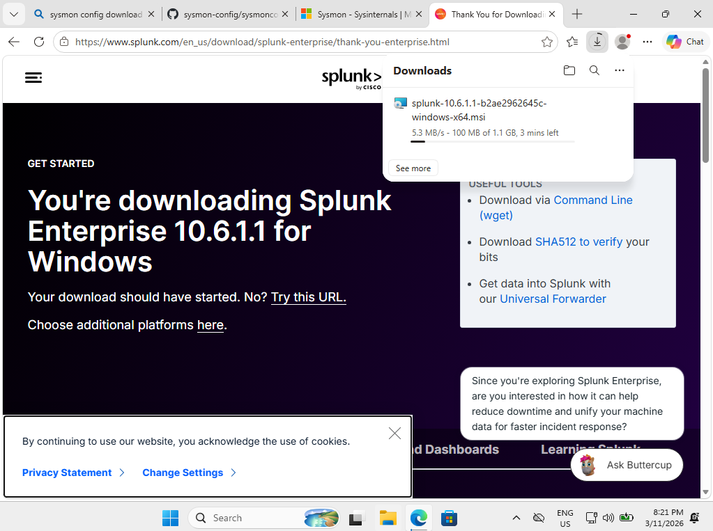

### 5. Getting the logs in

I set up the three log sources in `inputs.conf` instead of using the Add Data screen. The file is in [configs/inputs.conf](configs/inputs.conf).

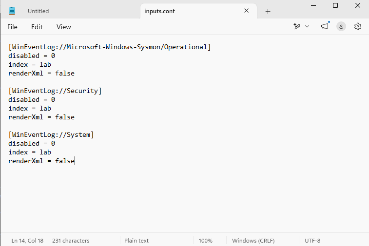

After restarting Splunk, Sysmon events started showing up:

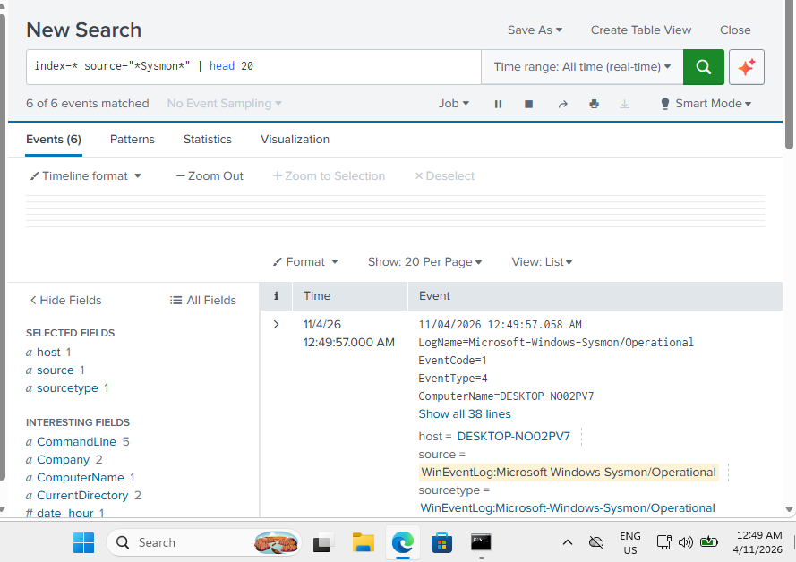

## Problems I ran into

This part took longer than everything else, and I learned the most from it.

**Splunk would not install.** The installer kept failing with "Error writing to file" on random files, and later with "ended prematurely". Two things were going on. Leftover files and processes from my earlier failed attempts were locking files, and the installer thought it was upgrading an old install. Windows Defender was also scanning every file as it was written. I cleaned out the old install, added a Defender exclusion for the Splunk folder and installed again, and it worked.

**Sysmon did not show up in Splunk.** On the Add Data screen, Security and System were listed but the Sysmon log was missing completely.

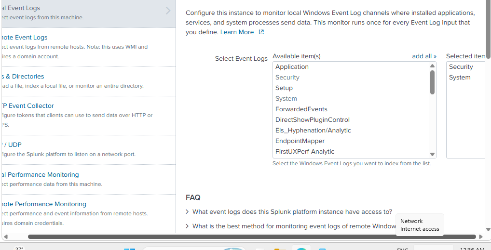

Newer Splunk versions on Windows run as a restricted service account by default, and that account is not allowed to read the Sysmon log. I fixed it by:

1. Changing the Splunkd service to run as Local System in `services.msc`
2. Adding the Sysmon log directly in `inputs.conf`
3. Restarting Splunk and checking the config loaded with `btool`

```
"C:\Program Files\Splunk\bin\splunk.exe" btool inputs list WinEventLog://Microsoft-Windows-Sysmon/Operational
```

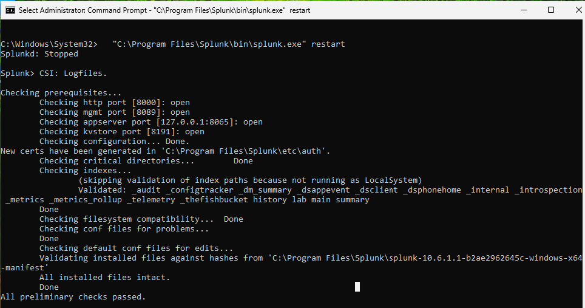

## The activity I generated

I used normal admin tools to do things that look like attacker behaviour. These create the same Windows events a real attack would.

| What I did | Event it creates | MITRE ATT&CK |
|---|---|---|
| Typed the wrong password several times on the lock screen | 4625 failed logon | T1110 Brute Force |
| Created a new local user called `backup_svc` | 4720 account created | T1136.001 Create Local Account |
| Added `backup_svc` to the Administrators group | 4732 member added to group | T1098 Account Manipulation |
| Created a scheduled task called `Updater` that opens Notepad at logon | 4698 scheduled task created | T1053.005 Scheduled Task |
| Ran `whoami`, `ipconfig /all` and `net user` in PowerShell | Sysmon Event 1 process created | T1059.001 PowerShell, T1087 Account Discovery |

The account name `backup_svc` and task name `Updater` were picked on purpose because attackers often use boring names like these to blend in.

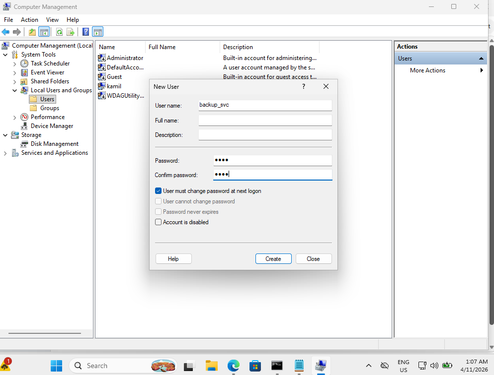

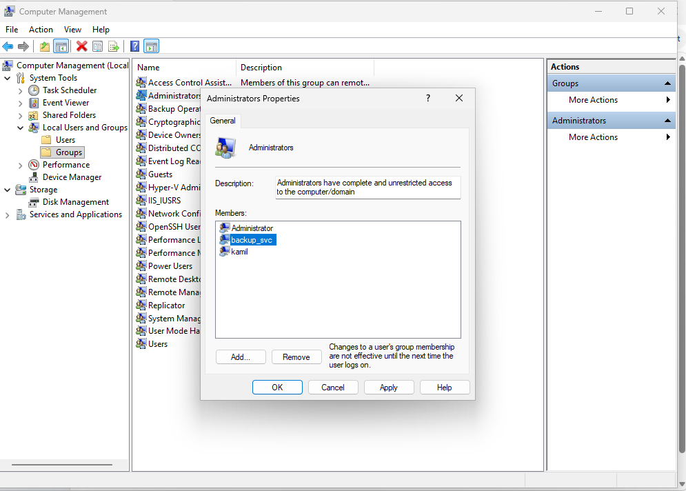

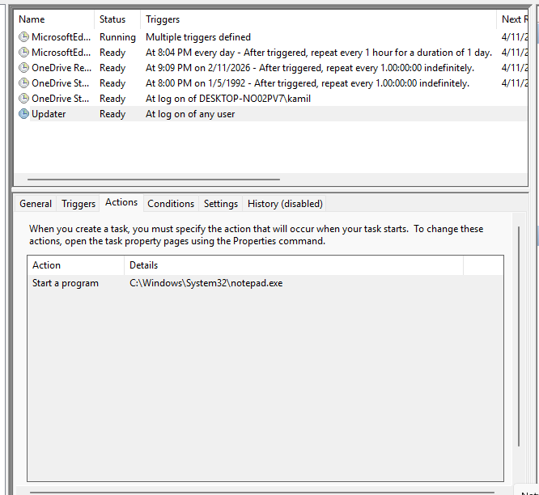

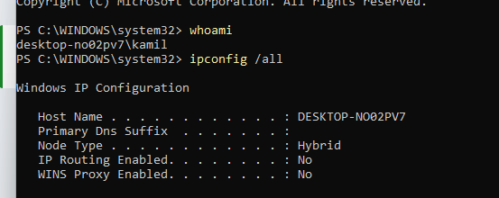

## Detections

All the searches are also in [configs/detections.spl](configs/detections.spl).

### 1. Repeated failed logins (4625)

```
index=lab EventCode=4625
| stats count by Account_Name
| where count > 3
```

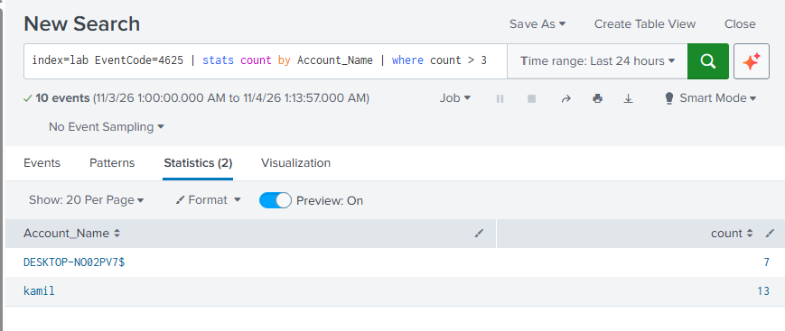

**What I found:** `kamil` has the highest count, from my wrong password attempts. The computer account `DESKTOP-NO02PV7$` also shows up. That is because each 4625 event has two account names in it, the account that asked for the login and the account that failed, and Splunk puts both into the `Account_Name` field. Accounts ending in `$` are computer accounts, so they should be filtered out of this search.

**What I would do as an analyst:** Check where the attempts came from and whether a successful login (4624) came right after them. A burst of failures followed by a success is a strong sign that a password was guessed.

### 2. New local account (4720)

```
index=lab EventCode=4720
| table _time, Account_Name, Subject_Account_Name
```

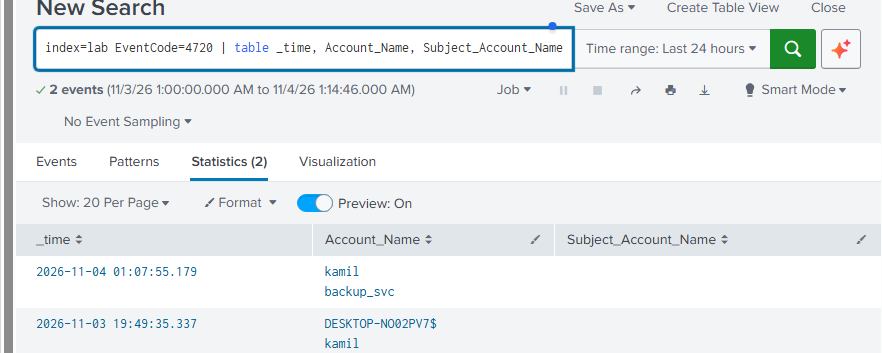

**What I found:** Two results. One is `backup_svc` being created by `kamil`. The other is from when my own `kamil` account was made during Windows setup.

**What I would do as an analyst:** Confirm with IT whether the account was expected. A new account that nobody requested, especially one that gets admin rights soon after, should be disabled and investigated.

### 3. User added to a group (4732)

```
index=lab EventCode=4732
| table _time, Group_Name, Member_Security_ID, Subject_Account_Name
```

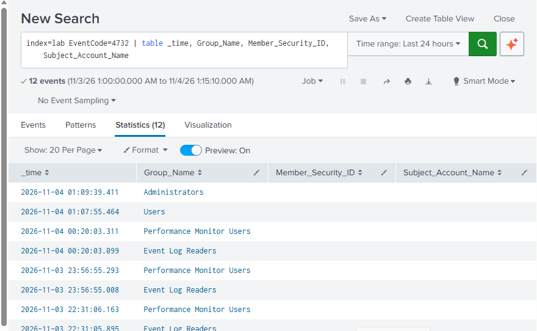

**What I found:** 12 results, but only one really matters: the change to **Administrators** at 01:09. The **Users** one is Windows adding the new account to the normal Users group. The rest are **Performance Monitor Users** and **Event Log Readers**, which happened at the same times I installed and restarted Splunk. Splunk adds its service account to those groups. This was a good lesson that normal software installs create a lot of noise.

**What I would do as an analyst:** Focus on privileged groups like Administrators. Anyone added to Administrators should be checked against an approved change.

### 4. Scheduled task created (4698)

```
index=lab EventCode=4698
| table _time, Task_Name, Account_Name
```

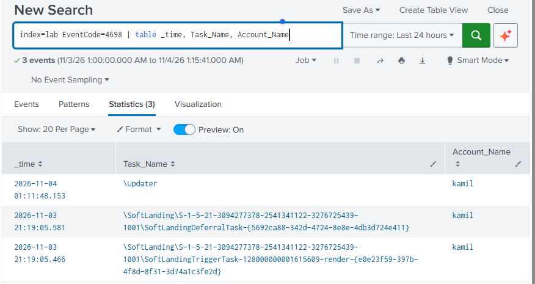

**What I found:** My `\Updater` task was caught. Two other tasks under `\SoftLanding` also showed up. Those were created by Windows itself, not by me.

**What I would do as an analyst:** Look at what the task runs. A task that starts at every logon and runs something from a strange folder is a common way for attackers to come back after a reboot.

### 5. Discovery commands (Sysmon Event 1)

```
index=lab source="*Sysmon*" EventCode=1 (CommandLine="*whoami*" OR CommandLine="*net user*" OR CommandLine="*ipconfig*")
| table _time, User, Image, CommandLine, ParentImage
```

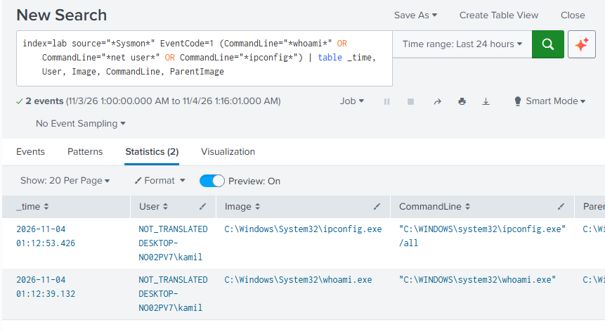

**What I found:** `whoami` and `ipconfig /all` were caught. `net user` was **not** caught, even though I ran it.

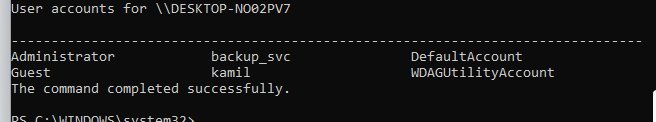

The reason is how Windows records the command. The command line is saved as `"C:\WINDOWS\system32\net.exe" user`, with the full path and quotes, so the text `net user` never appears in one piece. `net.exe` also starts a second program called `net1.exe` to do the actual work. This showed me that searching for the exact text you typed is not reliable.

**What I would do as an analyst:** One discovery command on its own is normal admin work. Several of them close together, run by an account that does not usually run them, is worth a closer look.

## What I would improve next

These are tuning changes I want to test next:

1. **Failed logins:** filter out computer accounts so only real users count.
   ```
   index=lab EventCode=4625 Account_Name!="*$"
   | stats count by Account_Name
   | where count > 3
   ```
2. **Group changes:** only alert on privileged groups.
   ```
   index=lab EventCode=4732 Group_Name="Administrators"
   ```
3. **Scheduled tasks:** skip the tasks Windows creates by itself.
   ```
   index=lab EventCode=4698 NOT Task_Name="\\SoftLanding\\*"
   ```
4. **Discovery:** match on the program name instead of the typed text, so `net user` is caught.
   ```
   index=lab source="*Sysmon*" EventCode=1 (Image="*\\net.exe" OR Image="*\\net1.exe" OR Image="*\\whoami.exe" OR Image="*\\ipconfig.exe")
   ```
5. Save each search as a scheduled alert in Splunk.
6. Move Splunk onto a second VM and send the logs over the network with the Universal Forwarder, which is how it is done in real companies.

## What I learned

- How Windows Security event IDs map to real attacker behaviour
- How to get Windows and Sysmon logs into Splunk with `inputs.conf`
- Why service account permissions matter when collecting logs
- That a detection is only useful once the noise is filtered out
- That attackers and admins often use the same tools, so context matters more than the command itself
